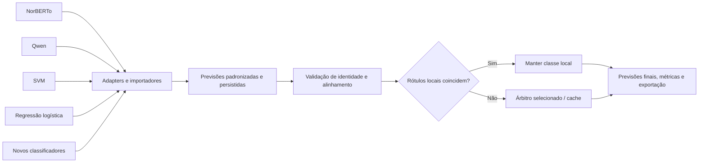

# Ensemble extensível

[Documentation index](../README.md)

This guide covers majority/consensus composition and arbitration. The current
probability-based soft-voting and stacking defaults include Qwen as a fourth
candidate/member; see their [dedicated workflow](ensemble-qwen.md) and
[measured results](../results/ensemble-qwen.md).

## Objetivo e escopo

`src/ensemble_classifier/` combina classificadores das classes
`c1`, `c234` e `c5`, preservando suas configurações, pré-processamentos e pesos.
A primeira versão deve combinar arquivos de previsões; a execução dos modelos
entra como uma camada opcional, separada do combinador.

Os classificadores permanecem **congelados e já treinados**. O plano não prevê
retreino, ajuste de pesos, calibração ou treinamento de um metaclassificador.
A avaliação final usa `data/test1-rotulado-para-teste-estatistico.xlsx`;
o holdout do EP1 não participa dessa avaliação.

A primeira implementação fornece seleção de membros, combinação offline,
roteamento de divergências e importação das decisões do árbitro selecionado. O
[guia do pacote](../../src/ensemble_classifier/README.md) apresenta os comandos.
Execução automática dos modelos e estratégias adicionais permanecem extensões.

## Compatibilidade com os classificadores existentes

| Origem | Interface existente | Saída | Integração proposta |
|---|---|---|---|
| NorBERTo | `NorbertoClassifier.predict()` e CLI `predict` | Rótulo e probabilidades por nome de classe | Adapter para a API ou importação de `predictions.jsonl` |
| Qwen | `qwen_classifier.inference.predict()` | Rótulo, probabilidades e logits em listas | Importação de `predictions.jsonl`, usando a ordem de classes do modelo |
| SVM | `SVMClassifier.predict()` e CLI `predict` | Rótulo e margens de decisão | Importação de `predictions.jsonl`; sem probabilidades artificiais |
| Regressão logística | `RLClassifier.predict()` e CLI `predict` | Rótulo, probabilidades e scores | Importação de `predictions.jsonl` |
| GPT/Codex | `gpt_classifier.pipeline.run()` | Rótulo, sem probabilidades de classe | Adapter de desempate e importação de previsões válidas para os casos encaminhados |
| Novo classificador | Contrato comum ou adapter | Rótulo; probabilidades e logits opcionais | Registro explícito de um novo tipo de adapter |

The original Qwen `validation-predictions.json` contains hard predictions,
not probabilities, and the selected run's export had a length-grouping row-order
bug. Do not use that original file for row-level ensemble inputs. The separately
recovered aligned export supports hard-label analysis only. Soft voting and
stacking use newly inferred, source-aligned probabilities from the saved adapter;
see the [ordering audit](../results/qwen-ep1-model.md#per-row-export-ordering-audit).

The majority presets use **NorBERTo + SVM + RL**, with one hard vote per model.
A strict majority decides; when all three labels differ, RL breaks the tie.
Qwen is optional in these presets. The earlier Qwen +
NorBERTo consensus with GPT arbitration remains an optional historical setup.

## Seleção de membros

`configs/ensemble.json` declara `qwen`, `norberto`, `svm` e `rl`. A lista `models`
seleciona a composição e pode ser substituída por `--models`, por exemplo
`--models qwen norberto svm` ou `--models svm rl`. Os membros não selecionados
não exigem resultados disponíveis, exceto quando escolhidos como árbitro.
Qualquer identificador
adicional pode apontar para outra execução que siga o contrato de arquivos.

The default is `norberto svm rl`, strategy `majority`, tiebreaker `rl`.
The alternative `consensus` strategy routes every disagreement to its selected
arbitrator. Changing composition or strategy creates a different identity and
must precede an official test2 delivery.

## Local majority configuration and exploratory comparison

The dedicated `configs/ensemble-majority.json` selects NorBERTo, SVM, and RL
with one hard vote each and RL as the fixed arbitrator for three-way ties.
`configs/ensemble-majority-test1.json` points to their saved test1 predictions.
Both pin development-only model manifests and require no GPT configuration.
The regular `ensemble.json` and `ensemble-test1.json` now use the same local
majority defaults following the user's explicit exclusion of Qwen.

Run the explicitly exploratory comparison on existing predictions:

```bash
PYTHONPATH=src python3 -m ensemble_classifier compare-majority \
  --config configs/ensemble-majority-test1.json \
  --input data/test1.xlsx \
  --gold data/test1-rotulado-para-teste-estatistico.xlsx \
  --output-dir results/ensemble-majority-comparison-new
```

The command evaluates all nonempty subsets, with each local model as the
fixed tiebreaker. Singletons appear once. The three-model preset produces
15 configurations, including isolated-model baselines and two-member pairs.
Predictions and configurations are persisted before reading gold, and every
source/gold row must align. Accuracy determines the ranking, with macro-F1
as a secondary ordering criterion; all maximum-accuracy ties are listed.

This command writes exploratory evidence rather than an official delivery
run; it does not require or generate test2 predictions. The official `combine`
protocol still requires test2 first. No result is promoted automatically.
The [measured comparison](../results/ensemble-majority.md) records 49.22% for
the best trio and 49.67% for RL alone on the previously consulted test1 set.

## Default training partitions and artifact selection

| Member | Selected training rows | Reserved rows | Artifact |
|---|---:|---:|---|
| NorBERTo | 16,093 | 3,999 | Unchanged original EP1 delivery adapter |
| SVM | 16,093 | 3,999 | Original fixed-holdout SVM |
| RL | 16,093 | 3,999 | `models/rl-development/`, generated with `bash scripts/rl/train.sh` |
| Qwen (optional, excluded) | 16,093 | 3,999 | Selected `models/qwen/adapter/`, exact EP1 split |

Holdout rows are reserved for evaluation, not used as training data. RL's
historical full-corpus package remains in `models/rl/`, but a missing
`rl-development/` bundle stops inference instead of selecting that old model.

Both ensemble configurations select `results/svm-development-test1` or
`-test2`, and `results/rl-development-test1` or `-test2`. NorBERTo retains its
`results/norberto-ep1-test1`/`-test2` paths. Each of these entries also declares
`manifest`, which pins the selected artifact identity before importing saved
predictions. Full-corpus predictions are rejected even if placed under the
configured directory name. This check applies to selected members and local
arbitrators. Default membership is NorBERTo + SVM + RL; Qwen is excluded.

Prepare RL only when needed:

```bash
bash scripts/rl/train.sh --dry-run
bash scripts/rl/train.sh
```

The first command is a read-only preflight; the second performs fixed-C
training on development only. The [RL guide](../../src/rl_classifier/README.md)
documents inference and generated artifacts. Training was not executed while changing these defaults. The user
subsequently completed it, and the exported development model is now verified.
Prediction outputs for each desired dataset are still a separate step.

## Seleção do responsável pelo desempate

`tiebreaker`, or CLI `--tiebreaker`, selects the arbitrator for unresolved
votes independently of `models`. The shipped configurations select `rl`;
omitting the field retains the backward-compatible `gpt` fallback. Other
configured members can be selected explicitly.

Exemplo: `--models qwen norberto --tiebreaker svm` mantém Qwen e NorBERTo
como membros e usa SVM para resolver suas discordâncias. `--tiebreaker-run`
permite informar o diretório de previsões do árbitro; para modelos locais,
o padrão é o caminho configurado em `members`. `--gpt-run` permanece como
alias exclusivo do GPT e não pode ser combinado com `--tiebreaker-run`.

Um membro também pode ser escolhido como árbitro. Sua previsão é reutilizada
como decisão final dos casos encaminhados, sem acrescentar outro voto ou
executar o modelo novamente. Um árbitro local externo aos membros exige uma
execução concluída e alinhada à fonte inteira, com identidade dos artefatos
conferida. Não se exige configuração GPT quando outro árbitro é selecionado.

O nome, os parâmetros e a identidade do árbitro ficam congelados no manifesto;
trocar o árbitro ou seus pesos invalida o vínculo de teste1 à entrega de teste2.
Os aliases antigos `consensus_gpt` e `majority_gpt` continuam aceitos para as
estratégias, sem sobrepor a seleção explícita de `tiebreaker`.

## Arquitetura



Estrutura implementada do núcleo offline:

```text
src/ensemble_classifier/
  config.py
  files.py
  arbitration.py
  strategies.py
  pipeline.py
  cli.py
```

`config.py` define a seleção e a configuração; `files.py` importa e valida
execuções concluídas; `arbitration.py` resolve a origem das decisões de
desempate. Os módulos de combinação não importam PyTorch,
Transformers, PEFT ou clientes remotos. A adição de um classificador pelo
contrato de arquivos exige somente sua configuração, sem alterar estratégias.

Uma extensão de adapters de execução poderá oferecer `describe()` e `predict(records)`, além
de liberação explícita de recursos quando aplicável. A entrada contém somente
identificador e texto; os rótulos verdadeiros ficam na camada de avaliação.
Cada adapter preserva o pré-processamento do modelo de origem.
A configuração distingue membros de base e árbitro; a inclusão de um novo membro
também exige declarar sua participação na estratégia de combinação.

## Contrato de previsões

Cada execução de um membro possui um manifesto com:

- Versão do esquema e identificador do classificador.
- Revisão e hashes dos artefatos, configuração e implementação.
- Vocabulário de classes e capacidades: rótulos, probabilidades e logits.
- Identidade da fonte, linhas esperadas, protocolo e partições de treinamento.
- Hash do arquivo de previsões e estado de conclusão.

O registro padronizado de inferência deve conter:

```json
{
  "excel_row": 2,
  "text_sha256": "<sha256>",
  "label": "c234",
  "probabilities": {"c1": 0.2, "c234": 0.6, "c5": 0.2}
}
```

`probabilities` e `logits` são opcionais e dependem das capacidades declaradas.
Listas são convertidas para nomes somente quando sua ordem estiver comprovada
pelo artefato. Rótulos de outro vocabulário exigem um mapeamento explícito,
completo e validado; não são convertidos por posição ou aproximação.

Antes de combinar, validar cobertura integral, IDs únicos, ordem, hash de cada
texto, fonte e conjunto de classes nos membros locais. Para GPT, exigir
cobertura integral **somente dos casos encaminhados por divergência**. A lista
desses casos deve ser persistida e conferida; a ausência de GPT nas linhas de
concordância é esperada. Textos repetidos em linhas diferentes
permanecem como registros distintos. Probabilidades devem ser finitas, estar
entre zero e um e somar um dentro de tolerância numérica documentada.

As previsões de validação importadas não devem propagar `gold` ao combinador.
Campos de uso, autenticação ou resposta remota não integram o contrato de
combinação. A procedência técnica fica no manifesto da execução.

## Regra inicial: concordância local e árbitro selecionado

1. Obter os rótulos dos membros selecionados para todas as linhas; as
   probabilidades, quando disponíveis, permanecem associadas ao modelo.
2. Se todos os rótulos coincidirem, usar essa classe sem consultar o árbitro.
3. Se divergirem, usar o rótulo do árbitro selecionado como decisão final.
   Com GPT, encaminhar somente o texto. O árbitro pode retornar qualquer classe do vocabulário
   `c1/c234/c5`, inclusive a terceira; atua como árbitro, não como voto
   permanente em uma maioria de três classificadores.
4. Registrar a origem da decisão, as classes locais, a indicação de
   encaminhamento e, quando aplicável, a classe e a identidade da execução do árbitro.

O request GPT não recebe o gabarito, as classes previstas pelos modelos locais
ou suas probabilidades. Preserva o contrato existente: alvo composto somente
por `resp_text`, com exemplos do treino quando previstos na configuração
congelada. Modelo, prompt, banco de demonstrações, recuperação e parâmetros
permanecem iguais entre teste2 e teste1.

O combinador offline gera a lista de divergências a partir dos arquivos locais.
As previsões do árbitro devem ser importadas ou produzidas em uma etapa explícita de
execução, com cache e orçamento. A combinação final exige todas as respostas
previstas; não inicia chamadas remotas automaticamente.

Probabilidades locais permanecem disponíveis para auditoria, associadas a
cada modelo. A saída do árbitro não recebe probabilidades artificiais. A
decisão final deve usar campos como `label` e `decision_source`, sem apresentar
a média local como distribuição de probabilidades da decisão do árbitro.

## Estratégias alternativas para extensão

As estratégias abaixo permanecem no desenho extensível, mas não definem a
decisão inicial com árbitro selecionável.

### Média de probabilidades

Para membros com probabilidades, calcular
`score(c) = sum(weight[m] * probability[m, c])`, com pesos não negativos e
soma igual a um. A classe final maximiza esse score. A alternativa inicial
documentada usa pesos fixos de 50% para Qwen e 50% para NorBERTo.

Probabilidades de modelos distintos não são automaticamente comparáveis em
calibração. Pesos iguais são um baseline, sem garantia de superar os membros.
Calibração, caso investigada, usa somente dados de desenvolvimento elegíveis;
seus parâmetros são congelados e incorporados à identidade do ensemble.

### Votação por rótulo

Para qualquer conjunto de membros, calcular
`score(c) = sum(weight[m] * indicator(label[m] == c))`.
Essa estratégia inclui modelos que fornecem somente rótulos.

Frequências de votos são scores de votação, não probabilidades calibradas.
Não transformar um rótulo GPT em uma probabilidade artificial para incluí-lo
na média de probabilidades. Uma estratégia que exija probabilidades deve
recusar membros sem essa capacidade.

### Empates nas estratégias alternativas

Definir um membro primário na configuração congelada. Entre classes empatadas,
usar a escolha desse membro quando ela estiver entre as empatadas; caso
contrário, usar uma ordem de classes previamente declarada. Com dois membros
de mesmo peso, a votação por rótulo apenas reproduz o membro primário nas
discordâncias; não oferece uma decisão majoritária adicional.

## Falhas e cobertura

Previsão local ausente ou inválida, ou resposta do árbitro pendente em uma divergência,
impede concluir a combinação. Limite de orçamento, recusa ou falha remota
preserva o estado pendente para retomada; não substitui o árbitro por uma classe
local. Não retirar silenciosamente membros nem renormalizar pesos por linha.
Uma composição ou política alternativa exige outra configuração e identidade.

## Avaliação final em teste1, sem retreino

The selected NorBERTo and the newly selected Qwen both use the frozen 16,093
development rows and 3,999 holdout rows. Qwen's earlier 16,010/4,082 split is
historical; optional Qwen entries now point to the saved EP1-split adapter.
Qwen remains excluded from the default NorBERTo/SVM/RL ensemble. Its holdout
selected the best checkpoint, while the weights were fitted only on development.
SVM and logistic regression now default to the same frozen 16,093 development
rows, reserving 3,999 holdout rows. The fixed EP1 parameters remain `C=0.05`
and `C=0.25`. The development-only RL artifact completed training and verification; its
fixed recipe can be reproduced using `bash scripts/rl/train.sh` with a new
output directory. The historical 20,092-row RL is not a fallback.

O protocolo inicial é:

1. Fixar os artefatos dos membros selecionados já treinados, o modelo e a configuração
   do árbitro, a regra de desempate e as estratégias de combinação. Não selecionar
   pesos, limiares ou prompts com os resultados de teste1.
2. Conferir a procedência dos membros: os textos, rótulos e grupos de teste1
   não podem ter entrado no treinamento ou no banco de demonstrações. Eventual
   sobreposição precisa ser identificada e declarada, mantendo todas as linhas
   na avaliação oficial.
3. Produzir teste2 como entrega, preservando linhas, textos e ordem.
4. Predizer teste1 com exatamente a mesma configuração congelada. O classificador
   recebe somente `resp_text`; o gabarito é acessado apenas na avaliação.
5. Medir accuracy, macro-F1, macro-precision, macro-recall, matriz de confusão e
   desempenho por classe nas 900 linhas de teste1. Comparar os membros locais
   e o ensemble nas mesmas linhas; usar a entrega original do EP1 para McNemar.
6. Informar a quantidade de casos encaminhados ao árbitro, a proporção de
   desempates, o consumo e o tempo, separadamente das métricas de qualidade.

O holdout do EP1 e a validação do Qwen pertencem ao histórico de treinamento e
seleção dos membros; não substituem o teste1 rotulado como avaliação final.
Teste1 já foi analisado em experimentos anteriores. Essa exposição deve ser
declarada no relatório; seus resultados não devem orientar mudanças na
combinação e uma reavaliação não deve ser apresentada como teste independente.

A entrada de um novo membro exige outra configuração e identidade. Ajustar
pesos, calibrar probabilidades ou usar stacking seria uma extensão distinta,
com dados de desenvolvimento adequados e protocolo próprio. Essas etapas não
fazem parte da configuração inicial.

## Execução, recursos e integração com o EP2

- Combinar previsões persistidas deve exigir apenas CPU e não iniciar
  classificadores, instalar pacotes ou realizar chamadas remotas.
- Gerar previsões de modelos locais em processos separados e sequenciais,
  persistindo cada resultado e liberando recursos antes do próximo. Não manter
  Qwen e NorBERTo simultaneamente na GPU de 8 GB.
- Usar cache por identidade do modelo, configuração, fonte e texto. Mudanças
  na estratégia podem reutilizar previsões válidas, sem nova inferência.
  No GPT, a identidade inclui o request, o banco de demonstrações e o runtime;
  somente as divergências exigem resposta. Reutilizar uma resposta não dispensa
  validar a configuração e a procedência.
- Preservar as proteções públicas de inferência do Qwen. O adapter não deve
  contornar verificações chamando funções internas de baixo nível.
- Congelar composição, pesos fixos, desempate, artefatos e configuração do árbitro antes da
  entrega. A identidade do ensemble inclui todos esses elementos.
- Predizer teste2 primeiro. Teste1 exige vínculo à execução concluída de teste2
  com a mesma identidade do ensemble e de todos os seus membros.
- Exportar os campos `excel_row`, `text_sha256` e `label` no formato já aceito
  por `gpt_classifier.delivery` e `gpt_classifier.evaluation`. Manter scores e
  procedência em campos adicionais ou arquivos separados.
- Comparar teste1 com a entrega original do EP1; uma inferência nova do
  NorBERTo não substitui o baseline histórico. Resultados históricos isolados
  de GPT em teste1 servem a diagnóstico, não à seleção de pesos.

## Etapas e critérios de aceite

1. **Núcleo offline:** contratos, importadores, alinhamento, estratégias e
   manifesto. Aceitar arquivos de NorBERTo, Qwen, SVM, regressão logística e GPT sem importar suas
   dependências de execução; produzir e validar a lista de divergências.
2. **Integração dos adapters:** conectar as APIs existentes com carregamento
   sob demanda, preservando configurações e protocolos; sem API de retreino.
3. **Configuração congelada:** fixar os modelos existentes e a regra de
   desempate, conferir a procedência dos dados e preparar as previsões;
   sem seleção de pesos, calibração ou retreino.
4. **Entrega e comparação:** produzir teste2, vincular teste1 e reutilizar
   exportação, métricas e McNemar do projeto.

A verificação futura do núcleo deve usar fixtures, incluindo ordem de classes
diferente, empate, NaN, linhas faltantes, duplicatas, hashes divergentes,
capacidades incompatíveis e composição alterada. Validar a independência de
bibliotecas ML e o bloqueio de teste1 sem teste2 correspondente. A integração
real dos modelos constitui uma etapa separada dessa verificação. Cobrir também
concordância sem uso do árbitro, divergência com decisão do árbitro, escolha
da terceira classe, seleção independente dos membros, reutilização de um
membro como árbitro e retomada de desempates pendentes, sem fallback implícito.
